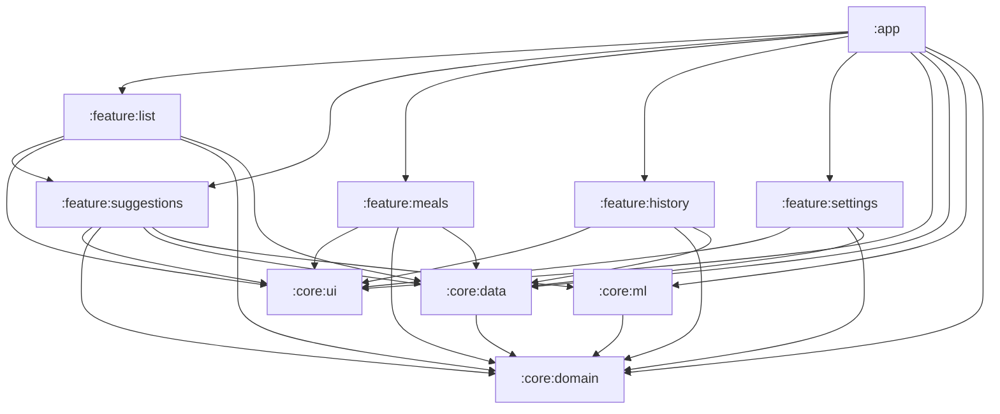

# Restock

Restock is a native Android grocery list that learns how often you buy things. Every time you check an item off, it records the purchase; after a few shopping trips it works out each item's typical re-purchase interval and suggests items that are due, so the list partly writes itself. Everything runs on-device: Room for storage, WorkManager for background pattern calculation, and a statistical model with a TensorFlow Lite hook for future ML.

> **Status: work in progress.** The domain, data and ML layers and the list/meals/suggestion UI components are implemented and unit-tested. App-level navigation and a few secondary screens are not finished yet. See [Project status](#project-status) for specifics.

## Features

Implemented in code:

- **Grocery list**: add items (with autocomplete over previously used and seeded common items), check/uncheck, delete, edit quantity, drag to reorder, clear checked items.
- **Purchase tracking**: checking an item records a purchase event.
- **Pattern learning**: from purchase history, computes an average re-purchase interval and a confidence score (`1 / (1 + CV)`, where CV is the coefficient of variation of intervals). Needs at least 3 purchases per item.
- **Smart suggestions**: items with a confident pattern that are due or overdue are scored (`confidence x (1 + urgency)`, urgency capped) and surfaced; suggestions can be accepted or dismissed.
- **Learning state**: the UI distinguishes "learning" from "ready" based on completed shopping trips (suggestions start at 3 trips).
- **Meal tags**: tag items with meals and view the list grouped by meal, with tag suggestions.
- **Background work**: a daily WorkManager job (Hilt-injected worker) recalculates patterns, with backoff and constraints.
- **On-device ML scaffolding**: a TFLite model manager, model-version manager and prediction wrapper. The statistical calculator is the primary predictor and the fallback when no model is present. **No trained `.tflite` model is bundled** (see `app/src/main/assets/README-TFLITE.md`).
- **Design system**: Compose theme (DM Sans, colour/shape/spacing tokens), reusable components, light/dark and font-scale previews, reduced-motion handling.

## Roadmap

Planned, not implemented (details in [`docs/`](docs/README.md)):

- Finish app-level navigation and the History, Settings and standalone Suggestions screens
- A trained TFLite model for interval prediction
- Phase 2: accounts and encrypted sync, billing, voice input, LLM-assisted parsing, recipe import
- Phase 3 and 4: visual intelligence and ecosystem integrations

## Architecture

Multi-module Gradle project (Kotlin DSL, version catalog in `gradle/libs.versions.toml`).

| Module | Responsibility |
|--------|----------------|
| `:app` | Application, `MainActivity`, navigation host, Hilt entry point |
| `:core:domain` | Pure Kotlin models, repository interfaces, ports, use cases (with unit tests) |
| `:core:data` | Room database, DAOs, entities, mappers, repository implementations, suggestion scorer |
| `:core:ml` | Pattern calculator, TFLite wrappers, WorkManager worker and scheduler |
| `:core:ui` | Theme, design-system components, shared ViewModel base, accessibility utilities |
| `:feature:list` | Grocery list screen and ViewModel |
| `:feature:suggestions` | Suggestion cards, animations, ViewModel |
| `:feature:meals` | Meal-tag screen, ViewModel, use cases |
| `:feature:history`, `:feature:settings` | Placeholder screens |



- **Presentation**: MVVM with unidirectional data flow. Each screen has a `UiState` (immutable, exposed as `StateFlow`), a sealed `Action` interface for user input, and a `SharedFlow` of one-shot `Event`s. Jetpack Compose with Material 3.
- **Domain**: use cases wrap single operations; `:core:domain` has no Android dependencies. `PatternCalculatorPort` and `PatternWorkScheduler` are ports implemented in `:core:ml`, keeping the dependency direction inward.
- **DI**: Hilt across all modules, including `@HiltWorker` for WorkManager and qualifiers for dispatchers and the application scope.
- **Data**: Room (entities for items, purchases, patterns, current list, meal tags, suggestion dismissals; exported schemas in `core/data/schemas`), repositories returning `Flow`.
- **Background work**: `PatternCalculationWorker` recalculates patterns periodically (daily, `KEEP` policy) and on demand.
- **ML**: DataStore tracks model version metadata. `PatternCalculator` is statistical; `TFLiteModelManager` loads an optional model from assets and the system falls back to the statistical result when the model is missing, fails, or there is too little history.

## Tech stack

Kotlin 2.0, Jetpack Compose (BOM 2024.12), Material 3, Navigation Compose, Hilt, Room, DataStore, WorkManager, Coroutines/Flow, kotlinx-datetime, kotlinx-collections-immutable, TensorFlow Lite, Coil. Testing: JUnit, MockK, Turbine, coroutines-test. Android Gradle Plugin 8.7, `minSdk` 26, `compileSdk`/`targetSdk` 35.

## Build, run, test

Requirements: JDK 17 and the Android SDK (set `sdk.dir` in an untracked `local.properties`, or `ANDROID_HOME`).

These are the commands the project and its CI define; the commands below were not re-verified as part of the latest documentation update.

```bash
./gradlew assembleDebug            # build the debug APK (app/build/outputs/apk/debug)
./gradlew installDebug             # install on a connected device/emulator
./gradlew testDebugUnitTest        # JVM unit tests
./gradlew connectedDebugAndroidTest  # instrumented tests (needs a device or emulator)
```

Release builds use the `release` build type in `app/build.gradle.kts`; no signing keys are included in the repository.

## Code quality

- **detekt** (`config/detekt/detekt.yml`, per-module baselines) and **ktlint** (`.editorconfig`): `./gradlew detekt ktlintCheck`; auto-format with `./gradlew ktlintFormat`.
- **Android Lint**: `./gradlew lint`.
- **Git hooks**: `.githooks/setup.sh` installs a pre-commit hook that runs ktlint and detekt.
- **CI** (`.github/workflows/ci.yml`): on pushes and PRs to `main`/`develop` it runs lint (detekt, ktlint, Android Lint), unit tests, then a debug build and uploads reports and the APK; instrumented tests run on an emulator for `main` and release PRs. `pr-comment.yml` posts a CI summary on pull requests.

## Project status

Early-stage, actively evolving. Honest notes for reviewers:

- The domain, data, ML and feature modules (list, suggestions, meals) are implemented with unit tests for the use cases, ViewModels and ML components.
- `RestockNavHost` in `:app` still renders placeholder screens rather than the feature screens, so the feature modules are not yet wired into the running app.
- `:feature:history` and `:feature:settings` are placeholders.
- `:app` references a `:benchmark` baseline-profile module that is not in the repository.
- detekt and ktlint currently report findings on some modules (the existing baselines are out of date), and the bundled font files under `core/ui/src/main/res/font` need replacing with the real DM Sans files.
- No trained TFLite model is shipped; predictions are statistical.

## Documentation

Design and planning material lives in [`docs/`](docs/README.md): product design doc, high-level plan, phase/sprint breakdowns and an early React UI prototype. These are design-time documents and describe intent rather than current behaviour.

## License

All rights reserved — license TBD.
